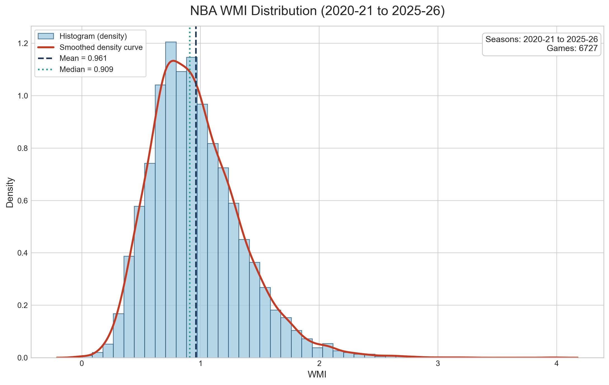

# NBA whistle research

The v2 software provides a reproducible recorded-foul prediction workflow: immutable source verification, independent schedule accounting, candidate possession reconstruction, traceable features, mathematical diagnostics, gated matched models and a development research notebook. The independent audit remains **BLOCKED**, with zero eligible games; software checks do not establish scientific validity. The legacy WMI release below is preserved.

Start with [current status](STATUS.md), [one-command pipeline](docs/PIPELINE.md), [research protocol](docs/RESEARCH_PROTOCOL.md) and [exposure inventory](docs/EXPOSURE_INVENTORY.md). Serve the repository and open **`/v2/`** for the generated development explorer. Its synthetic demonstrations and provisional data are explicitly labeled; no new empirical result or publication approval is implied.

## Development environment

Use CPython 3.14.7 (see `.python-version`) and Node.js 22. The pinned development environment in `requirements.lock` includes transitive scientific, test, lint, and build dependencies. It was resolved on macOS ARM64; CI is configured to check the same pins on Linux x86-64. Other Python minors and platforms are not currently supported. Dependency upgrades require regenerating the lock and rerunning the checks.

Create the project `.venv` and install the local package:

```bash
bash scripts/bootstrap.sh
```

If needed, select an existing interpreter with `PYTHON=python3.14 bash scripts/bootstrap.sh`. The bootstrap installs dependencies only inside `.venv` and fails when the requested interpreter version differs. It does not download Python or access NBA data.

Inspect recorded package/environment versions:

```bash
.venv/bin/python -m whistle_research environment
```

Run maintained Python lint, all Python tests, website unit checks, a wheel build, and an isolated installed-wheel smoke check:

```bash
.venv/bin/python scripts/check.py
```

The check preserves the historical CI lint scope and adds `src/`, `scripts/`, and `tests/v2/`; unrelated archived Python files are not lint targets. Tests remain offline. Use a new directory under `runs/` for exploratory output; never overwrite historical release artifacts. No confirmatory evaluation or new public scientific claim is allowed before the protocol and independent audit gates pass.

## Legacy WMI release

NBA Whistle Momentum Index is a possession-level basketball analytics project that asks a simple question:

> After recent defensive foul calls, do NBA games show short-term changes in foul-call momentum?

The public headline metric is `WMI`, calculated game by game. A separate validation study audits possession reconstruction and tests whether recent foul history improves prediction beyond basketball context.



## What WMI Measures

`WMI` compares whistle momentum after recent defensive fouls to whistle momentum without recent defensive fouls.

Core variables:

- `L_t`: equals `1` if at least one of the previous two possessions had a counted defensive foul.
- `F_t`: equals `1` if the current possession had a counted defensive foul.
- `N_t`: equals `1` if at least one of the next two possessions had a counted defensive foul.
- `M_t`: possession momentum score, defined as `F_t + F_t*N_t`.

Formula:

```text
WMI =
average(M_t where L_t = 1) / average(M_t where L_t = 0)
```

Interpretation:

- `WMI > 1`: more whistle momentum after recent fouls.
- `WMI ~= 1`: a small observed ratio difference; statistical equivalence is not established.
- `WMI < 1`: less whistle momentum after recent fouls.

WMI is a pattern metric. It is not proof of referee intent, bias, or misconduct.

## Current Results

The active comparison dataset covers 2020-21 through the available 2025-26 snapshot.

- Games with WMI: `6,727`
- Mean `WMI`: `0.960619`
- Median `WMI`: `0.909180`
- Percentiles are stored as `wmi_percentile`

Main outputs:

- `wmi_games_2020_21_to_2025_26.csv`
- `wmi_search_games_2019_2026.csv`
- `wmi_search_games_2019_2026_failures.csv`
- `wmi_distribution_2020_21_to_2025_26_summary.csv`
- `wmi_distribution_2020_21_to_2025_26_failures.csv`
- `wmi_distribution_2020_21_to_2025_26.png`

## Historical reproduction safeguards

Use the development commands at the top of this README for normal work. Legacy runners are preserved for historical comparison; several overwrite tracked release CSVs, plots, or website data by default, even when a small game limit is supplied.

Before a historical reproduction, create a separate disposable checkout or copy containing the required pinned inputs. Keep its output paths physically separate from the preserved checkout: do not share or symlink release directories. Inspect that script's write paths before running it. Distribution/search builders, plotting scripts, and legacy forecast/interval runners without an output override must run only in that isolated copy. A game-limit option does not redirect their output.

For legacy validation, explicitly select a new, previously nonexistent output directory with `--output`; use `--max-games` and `--build-only` for a reconstruction smoke run. Keep any historical model evaluation in the isolated copy as well. Preserve original release files and compare newly generated outputs before considering a deliberate replacement.

## Website

The static Whistle Atlas website is in `index.html`, `styles.css`, and `site.js`. It explains the research question, searches game-level WMI scores, and compares two selected games side by side. It is designed to run directly from the repository root and can be served by GitHub Pages.

Preview locally:

```bash
.venv/bin/python -m http.server 8000
```

The 22 October 2026 meeting packet is in `research/meeting_2026_10_22/`: a proposed problem statement and decision gate, the Indigo-format ten-source bibliography draft, an RIS file for Zotero, and a source tracker. Source annotations are preliminary until the full papers are read and page-numbered notes are added.

## Project Structure

- `wmi_utils.py`: shared possession parsing and WMI calculation logic.
- `calculate_wmi_any_game.py`: one-game WMI runner.
- `calculate_wmi_games_2025_26.py`: 2025-26 completed-game runner.
- `build_wmi_distribution_2020_2026.py`: multi-season WMI distribution builder.
- `build_wmi_search_dataset.py`: static website search dataset builder.
- `tests/`: active test suite.
- `index.html`, `styles.css`, and `site.js`: static MVP website.
- `PROJECT/`: formal definitions, project guide, and project history.
- `archive/controlled_experiments/`: paused controlled-WMI experiments, kept only as research history.

## Data Notes

The project uses publicly available NBA play-by-play data endpoints. Some game IDs are unavailable or incomplete through those endpoints; failures are logged explicitly in `wmi_distribution_2020_21_to_2025_26_failures.csv`.

The active product is game-by-game WMI. Completed-game lists are comparison context for percentiles and distribution plots, not a separate pooled season edition.

The website search dataset covers 2019-20 through the available 2025-26 snapshot, including regular season, playoffs, and play-in games where source play-by-play data is available. Unavailable source rows are logged in `wmi_search_games_2019_2026_failures.csv`.

## Status

This is a v1 research release. The metric is intentionally simple, explainable, and scoped to completed games.

## Audited validation release

The shared parser now splits at period changes, ignores administrative ownership changes when starting possessions, and reconstructs time without using future overtime. The WMI formula and global windows are unchanged. Existing CSV snapshots remain archived release data; `site-data/audited_games.csv` overlays recalculated games in search. Each row names its parser version and percentile reference cohort.

The historical study used `validate_wmi.py`, `forecast_foul_sequences.py`, and `validate_wmi_intervals.py`. Their default paths point at the preserved release, so they are not normal development commands. Apply the historical reproduction safeguards above; the forecast and interval scripts have no output-directory override.

The conditional sequence runner executes only when its historical replication gate passes. This does not satisfy the v2 independent audit gate. The main study uses the commit-pinned inputs in `research/hypotheses_2026_09_12/source_manifest.json`; the existing fetch helper verifies SHA256 hashes. Validation's `--evaluate-only` option reads saved possession partitions but still writes evaluation outputs, so it also requires an isolated copy and an explicit new output directory populated with the needed copied inputs.

Outputs live in `research/validation_2026_09_12/`: protocol, report, source/partition manifest, environment versions, parser and source comparisons, held-out predictions, calibration, residuals, and the expansion decision. Compressed possession partitions include model inputs and separately named outcomes. Current-possession shots/free throws are never prediction features. Missing shot-zone coverage is explicit.

The August expansion report is historical; its prediction claims are superseded by the matched context/history validation. A coverage stress test of circular block intervals found inconsistent coverage, so per-game confidence intervals remain withheld. The website shows sample counts and denominator diagnostics without asserting significance.
